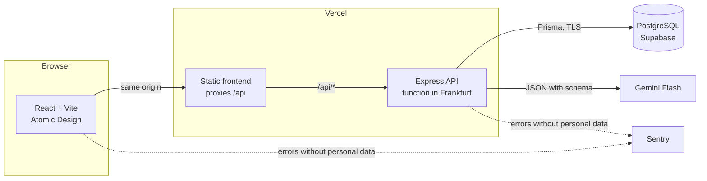
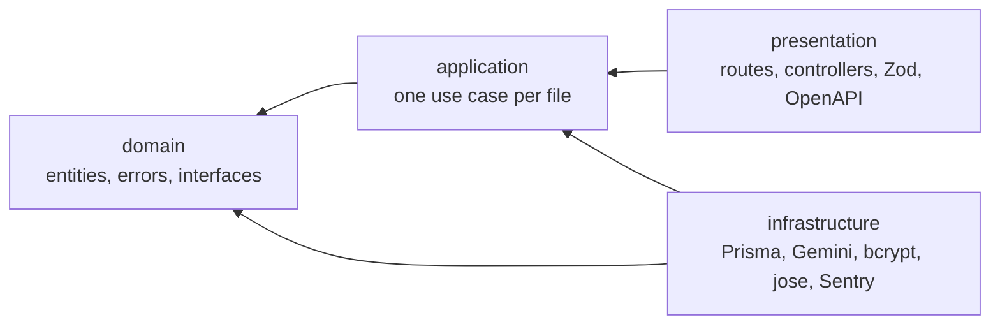

# DevPilot AI

**English** · [Español](README.es.md)

DevPilot AI turns a task or a bug described in plain language into a **technical specification ready to implement**. The specification has a technical description, user stories with acceptance criteria, frontend and backend tasks, risks and edge cases, test cases and a complexity estimate. When the description is missing information, the AI asks before making things up. The result can be edited, regenerated and exported to Markdown or JSON.

It is Juanjo Ortiz's master's thesis (October 2026): a complete application, deployed at zero cost, built with Clean Architecture in the backend and Atomic Design in the frontend.

| | |
| --- | --- |
| Application | <https://dev-pilot-ia-2tpc.vercel.app>: sign up; every new account gets a sample project |
| Swagger UI | <https://dev-pilot-ia-2tpc.vercel.app/api/docs>, when `API_DOCS_ENABLED=true` (SEG-17) |
| Storybook | `npm run storybook -w @devpilot/web`; CI builds it and publishes it as an artifact on every change |
| Documentation (Spanish) | [Requirements](docs/requirements.md) · [Architecture](docs/architecture.md) · [AI contract](docs/ai-contract.md) · [Threat model](docs/threat-model.md) · [Deployment](docs/deployment.md) |

The interface is available in English and Spanish. The screenshots below show the Spanish UI with the demo data.


## Features

| Module | What it does |
| --- | --- |
| Authentication | Sign up, sign in and sign out. A 15-minute access token kept only in memory, and a rotating refresh token in an httpOnly cookie. Attempt limits per email and per IP |
| Projects | Projects with a description, a tech stack and conventions, sent to the AI as context. A sample project for every new account |
| AI generation | Feature or bug in plain language → a six-section specification validated against a schema. Clarifying questions, explicit assumptions, retries, daily limits and visible states |
| Editing | Editor for every section, with the same validation as the AI's answer; the original version is kept. A warning before leaving with unsaved changes |
| History | Generations per project, paginated, with status, type and complexity. Regenerate and delete |
| Export | Markdown with checkboxes, JSON with a [public schema](docs/schemas/specification-export.v1.schema.json), and copy to clipboard |
| Dashboard | Indicators, daily activity, complexity and the most active projects, filtered by period and project |

The specification follows the interface language too: when the language changes, it is translated once and stored.

| Project and history | New generation |
| --- | --- |
|  |  |
| **Clarifying questions** | **Specification** |
|  |  |
| **Editor** | **Failure and retry** |
|  |  |

## Architecture



**Same origin.** The browser only talks to the frontend's domain, which forwards `/api` to the API. There is no CORS, and the refresh cookie can be `SameSite=Strict`.

**Backend: Clean Architecture.** Four layers in `apps/api/src`, with dependencies always pointing inwards. ESLint fails the CI if a layer imports from one it must not.



- `domain` imports neither Express, Prisma nor the model's SDK. It defines the interfaces (`GenerationRepository`, `LLMProvider`…) that `infrastructure` implements.
- Use cases receive their dependencies through the constructor, and `composition.ts` is the only file that knows every layer.
- Tests use in-memory repositories and a `FakeLLMProvider`: no test calls Gemini.

**Frontend: Atomic Design.** `atoms → molecules → organisms → templates → pages`, and each level only imports from lower ones (ESLint checks this too). Atoms and molecules are presentational; data arrives through TanStack Query from `features/` and `services/`. Storybook documents atoms and molecules.

## Project structure

```
apps/
  api/                  Express + Prisma
    prisma/             schema and migrations
    src/domain/         entities, errors and interfaces
    src/application/    use cases and services
    src/infrastructure/ Prisma, Gemini, security, monitoring
    src/presentation/   HTTP, controllers, validation and OpenAPI
  web/                  React + Vite
    src/components/     atoms, molecules, organisms, templates, pages
    src/features/       queries and mutations per area (TanStack Query)
    src/services/       API client
    src/i18n/           Spanish and English
packages/shared/        Zod schemas and types shared by web and API
docs/                   requirements, architecture, AI contract, threats, deployment
  schemas/              published JSON Schema of the export
.github/                CI, deployment and Dependabot
```

## Technical decisions

| Decision | Why |
| --- | --- |
| One Zod schema per contract, in `packages/shared` | The same schema validates the model's answer, edits and frontend forms, and generates OpenAPI and the export's JSON Schema, so they can't drift apart |
| The model's answer is untrusted | It is validated against the schema. If it fails there is one retry; if that fails too, the generation fails with a specific error code |
| Asynchronous generation | `POST` returns 202 and the frontend polls the status. A generation completes or fails within 45 s, with 20 s per attempt |
| No in-memory state in the API | On Vercel each request may hit a different instance: limits and attempts are counted in PostgreSQL, and background work is registered with `waitUntil` |
| Access token in memory, refresh token in a cookie | An XSS can't read a persistent token. The refresh token rotates on every use, and reusing one revokes every session |
| Vercel + Supabase | No credit card, and in Frankfurt next to the database. Docker is kept for local development and CI |
| Gemini Flash behind `LLMProvider` | Free tier. Switching providers is a new class in `infrastructure`; the use cases don't change |

## Security

The [threat model](docs/threat-model.md) lists assets, actors and 28 threats with their mitigations. Requirements SEG-01 to SEG-19 follow the OWASP Top 10:2025 and the LLM-specific risks, and each one has its test or check.

- **Access:** global authentication with an explicit list of public routes. Every query filters by the signed-in user, and someone else's resource answers 404.
- **Input and output:** Zod on every input. User text and model output are always rendered as text, never as HTML.
- **Prompt:** user text is delimited as data, and the instructions are fixed.
- **Limits:** daily generations per user and overall, login and sign-up attempts, and size limits on everything that goes into or comes out of the model.
- **Startup and secrets:** the API refuses to start with weak or sample secrets, or without TLS to the database. Secrets live only in environment variables.
- **Monitoring:** structured security event log, and Sentry without personal data.
- **Supply chain:** `npm audit` in CI, Dependabot, and actions pinned to a commit. See [SECURITY.md](SECURITY.md).

## AI contract

The specification has a fixed schema, `schemaVersion: 1`, described in [docs/ai-contract.md](docs/ai-contract.md). The model answers with structured JSON: either a specification or 2 to 4 clarifying questions. Each provider failure has its own code (`LLM_TIMEOUT`, `LLM_RATE_LIMITED`, `LLM_INVALID_RESPONSE`…), its own message in the interface and, when it makes sense, a retry.

## Running locally

### With Docker (recommended)

```bash
docker compose up --build
```

This starts PostgreSQL, applies the migrations, loads the demo data and starts the API and the web app. Open <http://localhost:8080> and sign in with **demo@example.com / devpilot-demo**, or create an account.

Docker uses the simulated model (`LLM_PROVIDER=fake`), so everything works without an API key. With a description shorter than 80 characters it asks questions; otherwise it returns a specification.

### Without Docker

You need Node 22.18 or later and a PostgreSQL, which can be the one from Compose:

```bash
cp .env.example .env
npm install
docker compose up -d db
npm run db:deploy
npm run db:seed          # sample data for demo@example.com / devpilot-demo
npm run dev:api          # http://localhost:3000
npm run dev:web          # http://localhost:5173, in another terminal
npm run storybook -w @devpilot/web   # http://localhost:6006
```

To use Gemini, set `LLM_PROVIDER=gemini` and `GEMINI_API_KEY` (from Google AI Studio) in `.env`.

## Environment variables

They are all in [.env.example](.env.example), with sample values that the API rejects in production.

| Variable | Purpose | Default |
| --- | --- | --- |
| `DATABASE_URL` | PostgreSQL. In production it requires `sslmode=require` or `verify-full` | — |
| `JWT_ACCESS_SECRET`, `JWT_REFRESH_SECRET` | Token signing: 32 bytes or more, and different | — |
| `LLM_PROVIDER` | `gemini` or `fake` | `fake` |
| `GEMINI_API_KEY`, `GEMINI_MODEL` | Gemini key and model | —, `gemini-3.5-flash-lite` |
| `GENERATION_DAILY_LIMIT_PER_USER`, `GENERATION_DAILY_LIMIT_GLOBAL` | Generations per day | 20, 200 |
| `AUTH_LOGIN_LIMIT_PER_EMAIL`, `AUTH_LOGIN_LIMIT_PER_IP`, `AUTH_REGISTER_LIMIT_PER_IP` | Authentication attempts | 5, 20, 10 |
| `LLM_ATTEMPT_TIMEOUT_MS`, `GENERATION_TIMEOUT_MS`, `LLM_MAX_OUTPUT_TOKENS` | Model timeouts and output cap | 20000, 45000, 8192 |
| `SENTRY_DSN` (API), `VITE_SENTRY_DSN` (web) | Error monitoring; nothing is sent without them | — |
| `API_DOCS_ENABLED` | Swagger UI and `/api/openapi.json` | `false` |
| `APP_VERSION` | Version reported by `/health`; on Vercel, the commit | `dev` |

## Tests

```bash
npm run lint               # ESLint (with the layer and level rules) and Prettier
npm run typecheck
npm test                   # API, web and shared, without a database; measures API coverage
npm run test:integration   # API against PostgreSQL
npm run build
```

- **API:** over 270 unit and HTTP-layer tests with Supertest, and 35 integration tests against PostgreSQL. Line coverage of `domain` and `application` is above 97%; the required minimum is 70%.
- **Web:** over 270 tests with React Testing Library, including one that renders every Storybook story.
- **Security requirements:** each one has its test. For example, isolation between users, refresh token reuse, prompt injection, and that an unexpected error doesn't leak details.

## Deployment

`develop` integrates the work and `main` is production. Both branches are protected and only accept pull requests with a green CI.

| Workflow | What it does |
| --- | --- |
| `ci.yml` | Dependency audit, lint, types, tests, migrations and integration tests on PostgreSQL, build, OpenAPI, Storybook and the Docker image |
| `deploy.yml` | Applies the migrations when the `develop` → `main` pull request opens; after the merge, checks that production answers with the new commit |
| Dependabot | Weekly updates for npm packages and actions |

Vercel publishes both projects (web and API) on every merge to `main`. The full guide, from Supabase to Sentry, is in [docs/deployment.md](docs/deployment.md) (Spanish).

## Known limitations

- **Free tiers.** Supabase pauses the database after a week without activity and makes no backups. Gemini has a shared daily quota, and on its free tier the content may be used to improve Google's products: the generation screen warns not to paste code or confidential data.
- **Cold starts.** The first request after a while without use takes a bit longer.
- **Deployment.** Vercel builds and publishes on its own; the pipeline applies migrations and verifies, but doesn't deploy through the Vercel CLI.
- **Out of scope.** Restoring the AI's original version from the interface (it is kept in the database), history filters, a chart by type, password recovery, email verification and teams.

## License

[MIT](LICENSE) © 2026 Juanjo Ortiz
