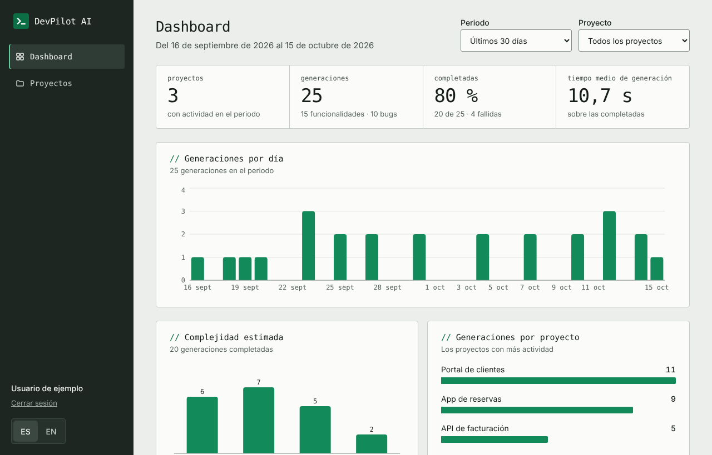
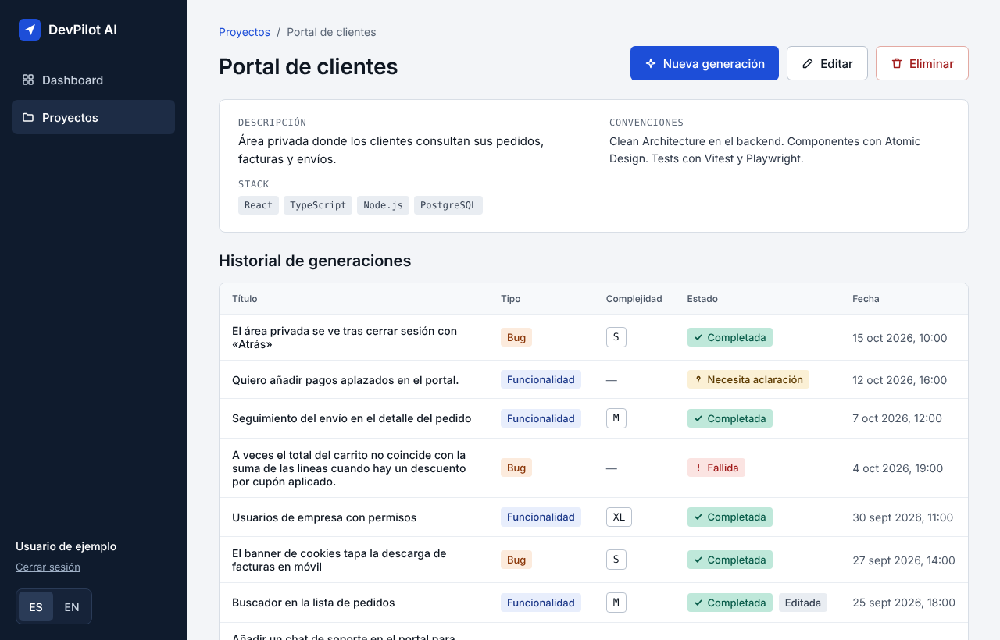
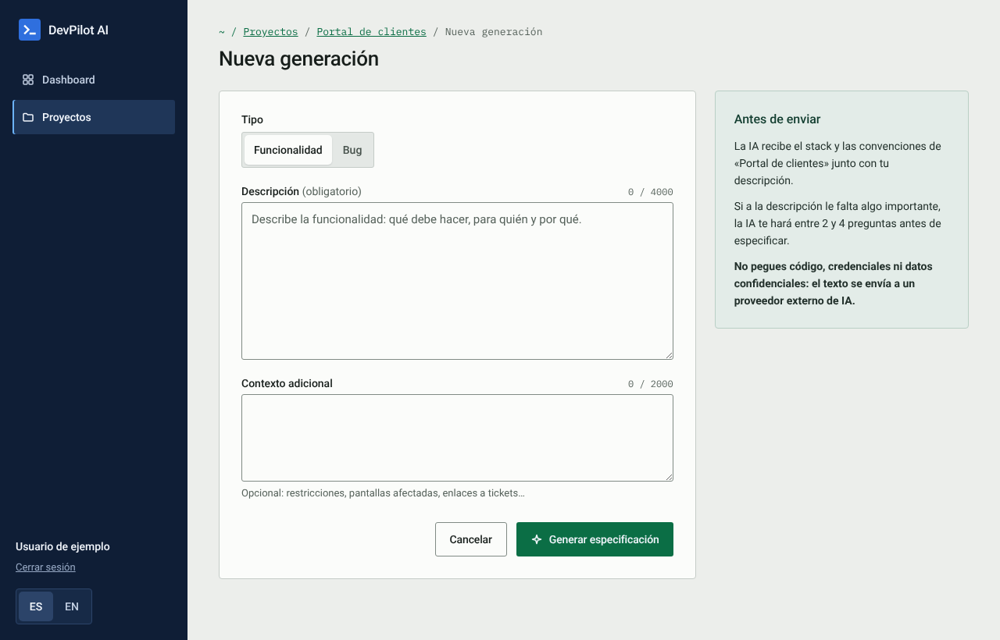
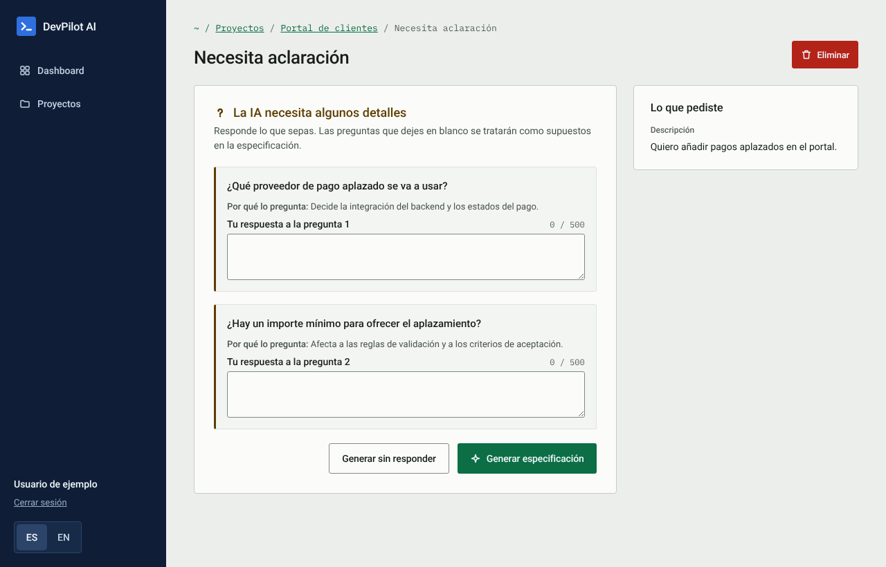
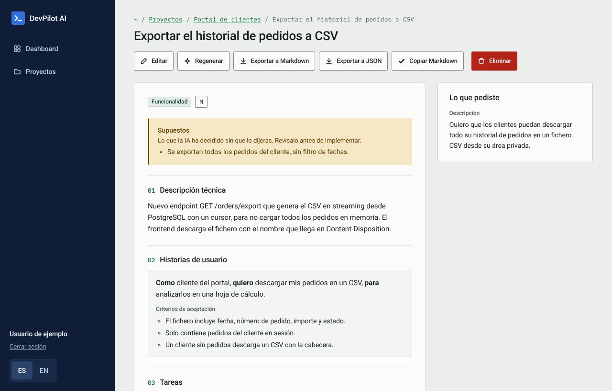
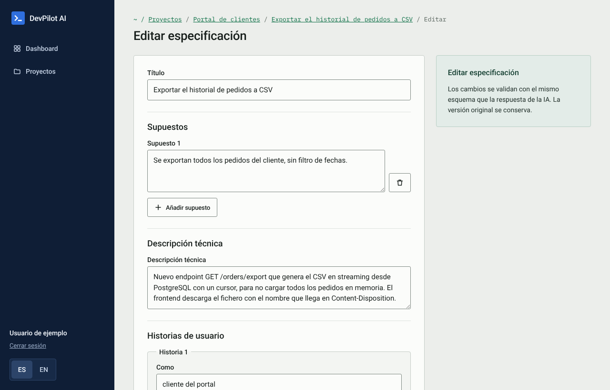
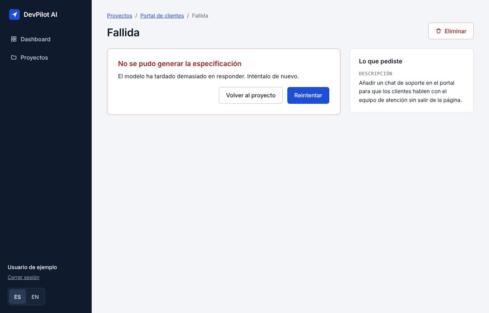
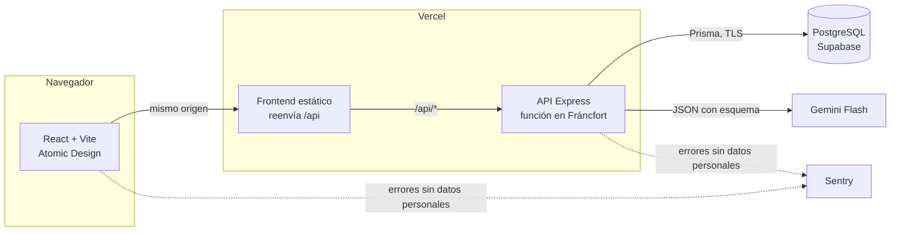
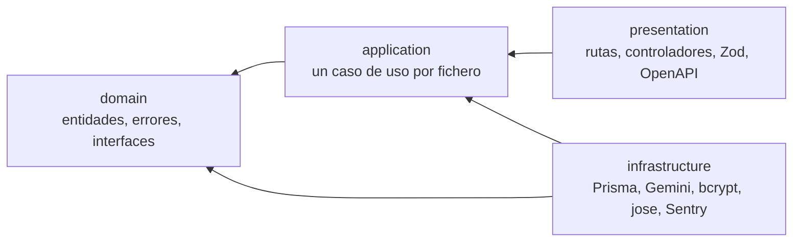

# DevPilot AI

DevPilot AI convierte una tarea o un bug descrito en lenguaje natural en una **especificación técnica lista para implementar**: descripción técnica, historias de usuario con criterios de aceptación, tareas de frontend y backend, riesgos y casos límite, casos de prueba y una estimación de complejidad. Si a la descripción le falta información, la IA pregunta antes de inventar. El resultado se edita, se regenera y se exporta a Markdown o JSON.

Es el trabajo de fin de máster de Juanjo Ortiz (octubre de 2026): una aplicación completa, desplegada y a coste cero, construida con Clean Architecture en el backend y Atomic Design en el frontend.

| | |
| --- | --- |
| Aplicación | <https://dev-pilot-ia-2tpc.vercel.app>: crea una cuenta; cada cuenta nueva recibe un proyecto de ejemplo |
| Swagger UI | <https://dev-pilot-ia-2tpc.vercel.app/api/docs>, cuando `API_DOCS_ENABLED=true` (SEG-17) |
| Storybook | `npm run storybook -w @devpilot/web`; el CI lo compila y lo publica como artefacto en cada cambio |
| Documentación | [Requisitos](docs/requirements.md) · [Arquitectura](docs/architecture.md) · [Contrato de IA](docs/ai-contract.md) · [Modelo de amenazas](docs/threat-model.md) · [Despliegue](docs/deployment.md) |



## Qué hace

| Módulo | Funcionalidad |
| --- | --- |
| Autenticación | Registro, inicio y cierre de sesión. Access token de 15 min solo en memoria y refresh token rotatorio en cookie httpOnly. Límite de intentos por email y por IP |
| Proyectos | Proyectos con descripción, stack y convenciones, que la IA recibe como contexto. Proyecto de ejemplo en cada cuenta nueva |
| Generación con IA | Funcionalidad o bug en lenguaje natural → especificación de seis secciones validada contra un esquema. Preguntas aclaratorias, supuestos explícitos, reintentos, límites diarios y estados visibles |
| Edición | Editor de todas las secciones con la misma validación que la respuesta de la IA; la versión original se conserva. Aviso al salir con cambios sin guardar |
| Historial | Generaciones por proyecto, paginadas, con estado, tipo y complejidad. Regenerar y eliminar |
| Exportación | Markdown con casillas, JSON con [esquema público](docs/schemas/specification-export.v1.schema.json) y copia al portapapeles |
| Dashboard | Indicadores, actividad por día, complejidad y proyectos con más actividad, filtrables por periodo y proyecto |

La interfaz está en español e inglés, y también la especificación: si cambias de idioma, se traduce una vez y se guarda.

| Proyecto e historial | Nueva generación |
| --- | --- |
|  |  |
| **Preguntas aclaratorias** | **Especificación** |
|  |  |
| **Editor** | **Error y reintento** |
|  |  |

## Arquitectura



**Mismo origen.** El navegador solo habla con el dominio del frontend, que reenvía `/api` a la API. No hay CORS y la cookie de refresh puede ser `SameSite=Strict`.

**Backend: Clean Architecture.** Cuatro capas en `apps/api/src`, con las dependencias siempre hacia dentro. ESLint hace fallar el CI si una capa importa de otra que no debe.



- `domain` no importa Express, Prisma ni el SDK del modelo: define las interfaces (`GenerationRepository`, `LLMProvider`…) que implementa `infrastructure`.
- Los casos de uso reciben sus dependencias por constructor, y `composition.ts` es el único fichero que conoce todas las capas.
- Los tests usan repositorios en memoria y `FakeLLMProvider`: ningún test llama a Gemini.

**Frontend: Atomic Design.** `atoms → molecules → organisms → templates → pages`, y cada nivel solo importa de los inferiores (también lo comprueba ESLint). Átomos y moléculas son presentacionales; los datos llegan por TanStack Query desde `features/` y `services/`. Storybook documenta átomos y moléculas.

## Estructura

```
apps/
  api/                 Express + Prisma
    prisma/            esquema y migraciones
    src/domain/        entidades, errores e interfaces
    src/application/   casos de uso y servicios
    src/infrastructure/ Prisma, Gemini, seguridad, monitorización
    src/presentation/  HTTP, controladores, validación y OpenAPI
  web/                 React + Vite
    src/components/    atoms, molecules, organisms, templates, pages
    src/features/      consultas y mutaciones por área (TanStack Query)
    src/services/      cliente de la API
    src/i18n/          español e inglés
packages/shared/       esquemas Zod y tipos compartidos por web y API
docs/                  requisitos, arquitectura, contrato de IA, amenazas, despliegue
  schemas/             JSON Schema publicado de la exportación
.github/               CI, despliegue y Dependabot
```

## Decisiones técnicas

| Decisión | Por qué |
| --- | --- |
| Un solo esquema Zod por contrato, en `packages/shared` | El mismo esquema valida la respuesta del modelo, las ediciones, los formularios del frontend y genera OpenAPI y el JSON Schema de la exportación: no pueden desincronizarse |
| La respuesta del modelo no es fiable | Se valida contra el esquema; si no lo cumple hay un reintento y, si vuelve a fallar, la generación queda fallida con un código de error concreto |
| Generación asíncrona | `POST` responde 202 y el frontend consulta el estado. Una generación termina o falla en 45 s, con 20 s por intento |
| API sin estado en memoria | En Vercel cada petición puede ir a una instancia distinta: límites e intentos se cuentan en PostgreSQL y el trabajo en segundo plano se registra con `waitUntil` |
| Access token en memoria y refresh en cookie | Un XSS no puede leer un token persistente. El refresh rota en cada uso y su reutilización revoca todas las sesiones |
| Vercel + Supabase | Sin tarjeta y en Fráncfort, junto a la base de datos. Docker se mantiene para el entorno local y el CI |
| Gemini Flash detrás de `LLMProvider` | Capa gratuita. Cambiar de proveedor es una clase nueva en `infrastructure`, sin tocar los casos de uso |

## Seguridad

El [modelo de amenazas](docs/threat-model.md) recoge activos, actores y 28 amenazas con su mitigación. Los requisitos SEG-01 a SEG-19 siguen el OWASP Top 10:2025 y los riesgos propios del LLM, y cada uno tiene su test o su comprobación.

- **Acceso:** autenticación global con lista explícita de rutas públicas. Cada consulta filtra por el usuario en sesión, y un recurso ajeno responde 404.
- **Entradas y salidas:** Zod en todas las entradas. El texto del usuario y la salida del modelo se muestran siempre como texto, nunca como HTML.
- **Prompt:** el texto del usuario va delimitado como dato y las instrucciones son fijas.
- **Límites:** generaciones por usuario y globales al día, intentos de login y de registro, y tamaño de toda entrada y salida del modelo.
- **Arranque y secretos:** la API no arranca con secretos débiles o de ejemplo, ni sin TLS hacia la base de datos. Los secretos solo viven en variables de entorno.
- **Monitorización:** registro estructurado de eventos de seguridad y Sentry sin datos personales.
- **Cadena de suministro:** `npm audit` en el CI, Dependabot y actions fijadas a un commit. Ver [SECURITY.md](SECURITY.md).

## Contrato de IA

La especificación tiene un esquema fijo, `schemaVersion: 1`, descrito en [docs/ai-contract.md](docs/ai-contract.md). El modelo responde con JSON estructurado: o una especificación o entre 2 y 4 preguntas aclaratorias. Cada fallo del proveedor tiene su código (`LLM_TIMEOUT`, `LLM_RATE_LIMITED`, `LLM_INVALID_RESPONSE`…), su mensaje en la interfaz y, cuando tiene sentido, la opción de reintentar.

## Puesta en marcha

### Con Docker (recomendado)

```bash
docker compose up --build
```

Levanta PostgreSQL, aplica las migraciones, carga los datos de demostración y arranca la API y la web. Abre <http://localhost:8080> y entra con **demo@example.com / devpilot-demo**, o crea una cuenta.

Docker usa el modelo simulado (`LLM_PROVIDER=fake`): todo funciona sin clave. Con una descripción de menos de 80 caracteres el modelo simulado hace preguntas; si no, devuelve una especificación.

### Sin Docker

Necesitas Node 22.18 o posterior y un PostgreSQL, que puede ser el del propio Compose:

```bash
cp .env.example .env
npm install
docker compose up -d db
npm run db:deploy
npm run db:seed          # datos de ejemplo para demo@example.com / devpilot-demo
npm run dev:api          # http://localhost:3000
npm run dev:web          # http://localhost:5173, en otra terminal
npm run storybook -w @devpilot/web   # http://localhost:6006
```

Para usar Gemini, pon `LLM_PROVIDER=gemini` y `GEMINI_API_KEY` (de Google AI Studio) en `.env`.

## Variables de entorno

Todas están en [.env.example](.env.example), con valores de ejemplo que en producción la API rechaza.

| Variable | Para qué | Por defecto |
| --- | --- | --- |
| `DATABASE_URL` | PostgreSQL. En producción exige `sslmode=require` o `verify-full` | — |
| `JWT_ACCESS_SECRET`, `JWT_REFRESH_SECRET` | Firma de los tokens: 32 bytes o más y distintos | — |
| `LLM_PROVIDER` | `gemini` o `fake` | `fake` |
| `GEMINI_API_KEY`, `GEMINI_MODEL` | Clave y modelo de Gemini | —, `gemini-3.5-flash-lite` |
| `GENERATION_DAILY_LIMIT_PER_USER`, `GENERATION_DAILY_LIMIT_GLOBAL` | Generaciones al día | 20, 200 |
| `AUTH_LOGIN_LIMIT_PER_EMAIL`, `AUTH_LOGIN_LIMIT_PER_IP`, `AUTH_REGISTER_LIMIT_PER_IP` | Intentos de autenticación | 5, 20, 10 |
| `LLM_ATTEMPT_TIMEOUT_MS`, `GENERATION_TIMEOUT_MS`, `LLM_MAX_OUTPUT_TOKENS` | Tiempos y tope de salida del modelo | 20000, 45000, 8192 |
| `SENTRY_DSN` (API), `VITE_SENTRY_DSN` (web) | Monitorización de errores; sin ellas no se envía nada | — |
| `API_DOCS_ENABLED` | Swagger UI y `/api/openapi.json` | `false` |
| `APP_VERSION` | Versión de `/health`; en Vercel, el commit | `dev` |

## Tests

```bash
npm run lint               # ESLint (con las reglas de capas y niveles) y Prettier
npm run typecheck
npm test                   # API, web y shared, sin base de datos; mide la cobertura de la API
npm run test:integration   # API contra PostgreSQL
npm run build
```

- **API:** más de 270 tests unitarios y de la capa HTTP con Supertest, y 35 de integración contra PostgreSQL. Cobertura de `domain` y `application` por encima del 97 % de líneas; el mínimo exigido es el 70 %.
- **Web:** más de 270 tests con React Testing Library, incluido uno que renderiza todas las historias de Storybook.
- **Requisitos de seguridad:** cada uno tiene su test. Por ejemplo, el aislamiento entre usuarios, la reutilización del refresh token, la inyección en el prompt o que un error inesperado no filtre detalles.

## Despliegue

`develop` integra el trabajo y `main` es producción. Las dos ramas están protegidas y solo aceptan pull requests con el CI en verde.

| Workflow | Qué hace |
| --- | --- |
| `ci.yml` | Auditoría de dependencias, lint, tipos, tests, migraciones e integración con PostgreSQL, build, OpenAPI, Storybook e imagen Docker |
| `deploy.yml` | Aplica las migraciones al abrir el pull request de `develop` a `main`; tras el merge, comprueba que producción responde con el commit nuevo |
| `keepalive.yml` | Visita `/api/v1/health` cada tres días para que Supabase no pause la base de datos |
| Dependabot | Actualizaciones semanales de npm y de las actions |

Vercel publica los dos proyectos (web y API) con cada merge en `main`. La guía completa, de Supabase a Sentry, está en [docs/deployment.md](docs/deployment.md).

## Limitaciones conocidas

- **Planes gratuitos.** Supabase pausa la base de datos tras una semana sin actividad y no hace copias de seguridad. Gemini tiene una cuota diaria compartida, y en su capa gratuita el contenido puede usarse para mejorar los productos de Google: la pantalla de generación avisa de no pegar código ni datos confidenciales.
- **Arranque en frío.** La primera petición tras un rato sin uso tarda algo más.
- **Despliegue.** Vercel compila y publica por su cuenta; el pipeline aplica las migraciones y verifica, pero no despliega con la CLI de Vercel.
- **Fuera del alcance.** Restaurar la versión original de la IA desde la interfaz (se conserva en la base de datos), filtros en el historial, gráfica por tipo, recuperación de contraseña, verificación de email y equipos.

## Licencia

[MIT](LICENSE) © 2026 Juanjo Ortiz
