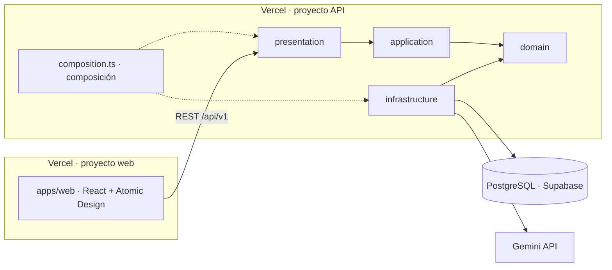

# Arquitectura

El sistema tiene tres piezas desplegadas por separado: frontend, API y base de datos. Todo funciona con planes gratuitos, sin AWS y sin dar una tarjeta.



## Stack

| Capa | Elección | A tener en cuenta |
| --- | --- | --- |
| Frontend | React + TypeScript + Vite, Atomic Design | Requisito del proyecto |
| Estado asíncrono | TanStack Query | Caché, reintentos y estados de carga y error |
| Rutas | React Router | Todo lo que no es login o registro exige sesión |
| Formularios | React Hook Form + Zod | Los mismos esquemas validan en cliente y en servidor |
| Gráficas | Recharts | Barras, líneas y donut del dashboard |
| Idiomas | react-i18next, español e inglés | Ningún texto escrito dentro de los componentes |
| Backend | Node.js + TypeScript + Express, Clean Architecture | Requisito del proyecto |
| Persistencia | PostgreSQL con Prisma | Misma base en local y en producción; migraciones y seed versionados |
| Base de datos en producción | Supabase, plan Free | 500 MB por proyecto y 2 proyectos activos; el proyecto se pausa tras 1 semana sin actividad; sin copias de seguridad |
| LLM | Gemini API, capa gratuita, modelo Flash | Salida estructurada nativa; límites por minuto y por día |
| Autenticación | JWT propio: access token corto + refresh token; bcryptjs para las contraseñas y jose para los JWT | Sin servicios de terceros |
| Hosting del frontend | Vercel | Reenvía `/api` a la API: frontend y API comparten origen |
| Hosting de la API | Vercel, plan Hobby: Express como función, en Fráncfort | Sin estado en memoria entre peticiones; 300 s como máximo por petición; solo uso no comercial |
| Entorno local | Docker Compose: API + PostgreSQL + web | Un solo comando levanta todo; el CI construye además la imagen de la API |
| Pruebas | Vitest, Supertest, React Testing Library | Mismo runner en frontend y backend |
| Monitorización | Sentry, plan Developer | 5.000 errores al mes |
| CI/CD | GitHub Actions | |
| Documentación de la API | OpenAPI generado desde los esquemas Zod, con Swagger UI | No puede quedar desfasada |
| Catálogo de componentes | Storybook por niveles de Atomic Design | |

Tres consecuencias de los planes gratuitos son requisitos:

- **API sin estado.** En producción la API se ejecuta como una función: la plataforma la suspende entre peticiones y puede haber varias instancias a la vez. Los límites de uso y de intentos se cuentan en la base de datos, nunca en memoria, y el trabajo que sigue después de responder se registra con `waitUntil`.
- **Cuota del LLM.** Al agotarla, Gemini responde 429. La aplicación limita las generaciones por usuario y explica el motivo.
- **Privacidad.** En la capa gratuita, el contenido enviado puede usarse para mejorar los productos de Google. La pantalla de generación avisa de que no se pegue código ni datos confidenciales.

## Monorepo

```
.
├── apps/
│   ├── web/                 # React + Vite
│   └── api/                 # Express + Prisma
├── packages/
│   └── shared/              # esquemas Zod y tipos compartidos
├── docs/
├── .github/workflows/       # ci.yml, deploy.yml, release.yml
├── docker-compose.yml
├── .env.example
├── CLAUDE.md
├── README.md                # inglés
└── README.es.md             # español
```

`packages/shared` contiene los esquemas Zod de peticiones, respuestas y de la especificación, además de los códigos de error. Frontend y backend los importan desde ahí; de los mismos esquemas sale la especificación OpenAPI.

## Backend: Clean Architecture

```
apps/api/src/
├── domain/
│   ├── entities/            # User, Project, Generation, RefreshToken
│   ├── repositories/        # interfaces de repositorio
│   ├── providers/           # LLMProvider (interfaz)
│   └── errors/              # errores de dominio con su código
├── application/
│   ├── use-cases/           # un caso de uso por fichero
│   ├── services/            # lógica que comparten varios casos de uso, como abrir una sesión
│   └── dto/
├── infrastructure/
│   ├── config/              # variables de entorno validadas al arrancar
│   ├── database/            # Prisma: cliente generado, repositorios, seed y datos de ejemplo
│   ├── security/            # bcrypt, JWT y reloj del sistema
│   └── ai/                  # GeminiProvider, FakeLLMProvider
├── presentation/
│   ├── http/                # app Express, rutas, middlewares, OpenAPI
│   ├── controllers/
│   └── validators/
├── test-support/            # dobles en memoria para los tests; no se compila
├── composition.ts           # composición: une implementaciones y casos de uso
├── main.ts                  # arranque como servidor: desarrollo y Docker
└── index.ts                 # arranque como función: Vercel
```

**Regla de dependencias.** Las dependencias apuntan siempre hacia `domain`:

- `domain` no importa frameworks ni librerías de infraestructura: ni Express, ni Prisma, ni el SDK del LLM.
- `application` solo depende de `domain`.
- `infrastructure` y `presentation` dependen de las capas interiores y nunca al revés.
- La composición (qué implementación recibe cada caso de uso) se hace solo en `composition.ts`, el único fichero que importa de todas las capas.
- `packages/shared`, que solo contiene esquemas Zod y tipos, se puede importar desde cualquier capa.

Lo comprueba en el CI la regla `no-restricted-imports` de `eslint.config.js` (RNF-01). Cambiar de proveedor de LLM o de base de datos solo toca `infrastructure`.

La interfaz `LLMProvider` se declara en `domain`, junto a las interfaces de repositorio; en `infrastructure/ai` quedan solo las implementaciones. Así los casos de uso no importan nada de infraestructura.

### Dos formas de arrancar

La misma aplicación arranca de dos maneras, y ninguna toca `domain`, `application` ni `presentation`:

| Fichero | Cuándo se usa | Qué hace |
| --- | --- | --- |
| `main.ts` | Desarrollo, Docker y cualquier hosting de contenedores | Abre el puerto y cierra con orden al recibir `SIGTERM` |
| `index.ts` | Vercel | Exporta la aplicación para que Vercel la ejecute como función y ajusta el pool de conexiones |

Los dos llaman a `compose()` de `composition.ts`. Vercel ejecuta el mismo JavaScript que compila `npm run build`, el mismo que va dentro de la imagen Docker: su configuración está en `apps/api/vercel.json`.

Dos reglas que impone ejecutarse como función:

- **Nada de estado en memoria entre peticiones.** Una instancia puede desaparecer o duplicarse en cualquier momento.
- **El trabajo en segundo plano se declara.** Lo que siga después de enviar la respuesta, como una generación tras el 202, se pasa a `waitUntil` de `@vercel/functions`; sin eso, la plataforma puede suspender la instancia a mitad.

## Frontend: Atomic Design

```
apps/web/src/
├── components/
│   ├── atoms/               # Button, LinkButton, TextInput, Tag, StatusBadge, Icon…
│   ├── molecules/           # FormField, TagInput, SearchField, ConfirmDialog, Pagination…
│   ├── organisms/           # LoginForm, ProjectForm, ProjectBrowser, GenerationHistory…
│   ├── templates/           # AuthLayout, AppLayout, FormPageLayout
│   └── pages/               # una por ruta, más AppShell: lo común a las páginas con sesión
├── features/
│   ├── auth/                # sesión y guardas de rutas
│   ├── forms/               # cómo llega a un formulario lo que la API rechaza
│   ├── projects/            # consultas y cambios de proyectos e historial (TanStack Query)
│   ├── ai-analysis/         # generación, edición y exportación
│   └── dashboard/
├── services/                # cliente HTTP, llamadas a la API y caché de datos
├── hooks/
├── i18n/                    # configuración, ficheros es / en y formato de fechas
├── styles/                  # tokens de diseño y estilos globales
├── test/                    # utilidades y datos de los tests
├── types/
├── routes.ts                # las rutas, en un solo sitio
└── App.tsx                  # qué página corresponde a cada ruta
```

Reglas (RNF-02):

- Un nivel solo importa niveles inferiores.
- Átomos y moléculas no llaman a la API ni usan estado global.
- Las páginas componen plantillas y organismos; el acceso a datos vive en `features`, `services` y `hooks`.
- Storybook sigue la misma jerarquía.

Las mismas reglas están en `eslint.config.js`, junto con la que prohíbe `dangerouslySetInnerHTML`. Cada componente vive en su carpeta con su CSS Module; los colores y tamaños salen de `styles/tokens.css`.

**Datos del servidor.** Cada área de `features` tiene sus consultas y cambios de TanStack Query junto a sus claves de caché. Una página pide los datos y se los pasa a los organismos, que no saben de dónde vienen. Tras crear, editar o eliminar algo, la consulta afectada se vuelve a pedir: por eso un proyecto nuevo aparece en la lista sin recargar (RF-PRO-01). Al cambiar de sesión la caché se vacía entera.

**Formularios.** Un campo se monta con `FormField`, que enlaza etiqueta, control, ayuda y error; el control puede ser una entrada, un área de texto o una lista de etiquetas. El formulario valida con el mismo esquema de `packages/shared` que la API, y lo que la API rechace después se muestra en su campo.

**Estados.** Cada vista con datos resuelve los tres estados de RNF-09 con `LoadingPanel`, `EmptyState` y `ErrorPanel`.

## Modelo de datos

Cuatro tablas: un usuario tiene muchos proyectos y un proyecto tiene muchas generaciones. Borrar un proyecto borra sus generaciones.

| Entidad | Campos principales | Notas |
| --- | --- | --- |
| User | id, name, email, passwordHash, createdAt | Email único |
| RefreshToken | id, userId, tokenHash, expiresAt, revokedAt | Se guarda el hash, nunca el token |
| Project | id, userId, name, description, techStack, conventions, createdAt, updatedAt | techStack es una lista de etiquetas |
| Generation | id, projectId, type, inputText, additionalContext, status, errorCode, clarifyingQuestions, clarificationAnswers, aiSpec, editedSpec, title, complexity, model, attempts, durationMs, inputTokens, outputTokens, isSample, createdAt, completedAt, editedAt | aiSpec, editedSpec, clarifyingQuestions y clarificationAnswers son JSONB; title y complexity se copian fuera del JSON para listar y agregar sin leerlo; isSample marca la generación de ejemplo, que no cuenta para los límites de uso |

Valores cerrados: `type` es `feature` o `bug`; `status` es `generating`, `needs_clarification`, `completed` o `failed`. La especificación vigente es `editedSpec` si existe y `aiSpec` en caso contrario.

Al registrarse, cada cuenta recibe un proyecto de ejemplo con una generación marcada con `isSample` (RF-PRO-06). Se crea desde un fichero del repositorio, sin llamar al LLM.

## API REST

21 endpoints bajo `/api/v1`. Todos salvo registro, login, refresh y health exigen un access token válido.

| Método | Ruta | Descripción |
| --- | --- | --- |
| POST | /auth/register | Crea la cuenta e inicia sesión |
| POST | /auth/login | Inicia sesión |
| POST | /auth/refresh | Renueva el access token con la cookie de refresh |
| POST | /auth/logout | Revoca el refresh token |
| GET | /auth/me | Datos del usuario en sesión |
| GET | /projects | Lista los proyectos del usuario |
| POST | /projects | Crea un proyecto |
| GET | /projects/:id | Detalle de un proyecto |
| PATCH | /projects/:id | Edita un proyecto |
| DELETE | /projects/:id | Elimina un proyecto y sus generaciones |
| GET | /projects/:id/generations | Historial paginado con `page` y `pageSize`, de más reciente a más antigua |
| POST | /projects/:id/generations | Lanza una generación; responde 202 |
| GET | /generations/:id | Estado y especificación de una generación |
| PATCH | /generations/:id | Guarda la versión editada con su idioma; la de la IA se conserva |
| POST | /generations/:id/restore | Descarta la edición y vuelve al original (RF-EDI-03, prescindible: aún no existe) |
| POST | /generations/:id/answers | Envía las respuestas a las preguntas aclaratorias, o `skip: true` para generar sin responder; solo en `needs_clarification`; responde 202 |
| POST | /generations/:id/regenerate | Crea una generación nueva con la misma entrada, en `language`; cuenta para los límites; responde 202 |
| DELETE | /generations/:id | Elimina una generación |
| GET | /generations/:id/export | Descarga la especificación vigente con `format=md` o `format=json` y `language=es\|en` para los títulos del fichero; 409 `SPECIFICATION_NOT_READY` si aún no hay especificación |
| GET | /generations/:id/translation | La especificación vigente en `language=es\|en`; la traduce con el modelo la primera vez y la guarda |
| GET | /dashboard/summary | Indicadores, actividad de los últimos 30 días y reparto por complejidad; los filtros `from`, `to` y `projectId` llegan con RF-DAS-06 |
| GET | /health | Comprobación de vida de la API y de la base de datos |

La especificación OpenAPI se sirve en `/api/openapi.json` y Swagger UI en `/api/docs`. Las dos rutas son públicas, se activan con una variable de entorno y no cuentan entre los 21 endpoints.

Todos los errores comparten formato:

```json
{ "error": { "code": "LLM_RATE_LIMITED", "message": "...", "details": {} } }
```

## Sesión

- No hay cuenta de demostración: el acceso es siempre con una cuenta registrada.
- Access token de 15 minutos, guardado solo en la memoria del navegador, nunca en `localStorage`; al recargar la página se recupera con `/auth/refresh`.
- Refresh token de 7 días en la cookie `devpilot_refresh`: httpOnly, `SameSite=Strict`, `Secure` en producción y con ruta `/api/v1/auth`, así que el navegador solo la envía a los endpoints de autenticación.
- El refresh token rota en cada uso; reutilizar uno ya usado revoca todas las sesiones del usuario. En la base de datos se guarda su hash SHA-256, nunca el token.
- La cookie viaja porque frontend y API comparten origen: ver «Mismo origen» más abajo.
- Los dos tokens son JWT firmados con HS256, cada uno con su secreto (`JWT_ACCESS_SECRET` y `JWT_REFRESH_SECRET`) y con su tipo en `aud`: uno nunca vale como el otro. La API no arranca con secretos de menos de 32 bytes, iguales entre sí o, en producción, de ejemplo.
- Las contraseñas se guardan con bcrypt de coste 12. El registro las limita a 72 bytes, que es lo que bcrypt tiene en cuenta.
- El login responde igual, y tarda lo mismo, con una contraseña incorrecta que con un email sin cuenta.

**Autenticación por defecto.** Un único middleware protege todo `/api/v1`. Las rutas públicas son la lista `PUBLIC_ROUTES` de `presentation/http/app.ts`: health, registro, login y refresh. Cualquier otra ruta responde 401 sin access token, exista o no (SEG-15).

**Renovación sin carreras.** Como cada refresh token vale una sola vez, el frontend nunca lanza dos renovaciones a la vez: dentro de una pestaña comparten una misma petición y, entre pestañas, se turnan con un bloqueo del navegador (Web Locks). Sin eso, la API tomaría la segunda por un robo y cerraría todas las sesiones.

## Proyectos e historial

- **Aislamiento por usuario.** Los repositorios de proyectos y generaciones reciben siempre el id del usuario en sesión y lo llevan a la condición de la consulta, también al editar y al borrar. Un proyecto de otra persona se comporta como uno que no existe: 404, con la misma respuesta (SEG-01 y RNF-06). El dueño de un proyecto sale del access token, nunca del cuerpo de la petición.
- **Ids de la URL.** Un id que no es un UUID responde 404 sin llegar a la base de datos.
- **Última actividad.** Es lo más reciente entre la última generación del proyecto y su última edición. La lista de proyectos va ordenada por ella; la búsqueda por nombre se hace en el navegador, sobre la lista ya cargada.
- **Historial.** Cada fila lleva lo necesario para la lista: título o, si aún no lo hay, el comienzo de lo que escribió el usuario. La especificación no se lee hasta abrir la generación. La página tiene 10 filas por defecto y 50 como máximo.
- **Borrado.** Eliminar un proyecto elimina sus generaciones por la clave ajena (`ON DELETE CASCADE`), en la misma operación.
- **Pantallas estrechas.** La tabla del historial mide el ancho de su contenedor: cuando no caben las cinco columnas, cada generación se pinta como una tarjeta, sin desplazamiento lateral.

Los filtros del historial (RF-HIS-02) son de nivel «prescindible» y no están implementados. Abrir una generación (RF-HIS-03) llega con el visor de la especificación.

## Dashboard y exportación

- **Agregados en la base de datos.** `GET /dashboard/summary` cuenta filas con `groupBy` y `aggregate` de Prisma, siempre con el usuario en la condición; nunca lee las especificaciones. La actividad son las fechas de creación de los últimos 30 días, agrupadas por día UTC en el caso de uso, con los días sin generaciones a cero.
- **Proyectos con más actividad (RF-DAS-04).** Los cinco con más generaciones, sin los que no tienen ninguna, en barras horizontales de HTML para que los nombres largos se lean enteros.
- **Qué cuenta cada indicador.** Proyectos y generaciones son todos los del usuario. El porcentaje de completadas es completadas entre el total. El tiempo medio es la media de `duration_ms` (tiempo con el modelo) de las completadas que no son de ejemplo. La complejidad reparte solo las completadas.
- **Sin datos.** Con cero generaciones, el dashboard muestra una invitación a ir a proyectos en lugar de gráficas vacías.
- **Recharts aparte.** La página del dashboard y las librerías de gráficas se descargan en su propio fichero (`React.lazy` y el grupo `charts` de `vite.config.ts`): el resto de la aplicación no las carga.
- **Exportación a Markdown.** La genera la API (`application/services/SpecificationMarkdown.ts`) a partir de la especificación vigente: la editada si existe y, si no, la de la IA. Lleva el título, los supuestos y las seis secciones; los criterios de aceptación y las tareas son listas de casillas (`- [ ]`). Los títulos de las secciones van en el idioma de la interfaz; el contenido, en el que se generó. El nombre del fichero es el título en ASCII, sin comillas, para que no pueda romper la cabecera `Content-Disposition`.

## Edición, regeneración y borrado

- **Editar (RF-EDI-01 y 02).** La página `/generations/:id/edit` edita todas las secciones: se pueden cambiar, añadir y quitar supuestos, historias con sus criterios, tareas, riesgos, casos límite y casos de prueba con sus pasos. El formulario valida con `specificationSchema`, el mismo que la respuesta de la IA, y la API vuelve a validar. Los motivos de error son códigos de `FIELD_ERRORS` (`TEXT_REQUIRED`, `TEXT_TOO_LONG`, `LIST_REQUIRED`, `TOO_MANY_ITEMS`).
- **Qué se guarda.** La versión editada va a `edited_spec` y la de la IA (`ai_spec`) no se toca. `title` y `complexity` se copian de la editada para el historial y el dashboard. Se edita lo que se ve: si la interfaz está en otro idioma, la traducción; la generación guarda el idioma de la versión editada y descarta las traducciones anteriores.
- **Cambios sin guardar (RF-EDI-04).** Salir del editor con cambios pide confirmación, tanto al navegar dentro de la aplicación (`useBlocker`, que necesita el router de datos de `main.tsx`) como al cerrar o recargar la pestaña (`beforeunload`).
- **Regenerar (RF-GEN-06).** Crea una generación nueva con la misma entrada y en el idioma de la interfaz; la anterior se conserva. Pasa por `CreateGeneration`, así que cuenta para los límites diarios.
- **Eliminar (RF-HIS-04).** Pide confirmación y vuelve al proyecto.
- **Exportar y copiar (RF-EXP-02 y 03).** El JSON es la especificación vigente tal cual, con `schemaVersion`. «Copiar Markdown» pide el Markdown a la API y lo copia con `ClipboardItem`, que Safari acepta aunque el texto llegue después del clic.

## Proyecto de ejemplo

Al registrarse, `RegisterUser` crea con `SampleProjectProvisioner` un proyecto de ejemplo y una generación completada marcada con `isSample` (RF-PRO-06). El contenido está en `application/samples/sampleProject.ts`: no llama al modelo, no cuenta para los límites y no entra en el tiempo medio del dashboard. Se puede editar y eliminar como cualquier otro. Si fallara al crearse, la cuenta y la sesión siguen adelante.

## Idioma de la especificación

- **Se escribe en el idioma de la interfaz.** Cada generación guarda en `language` el idioma en que escribió el modelo: el de la interfaz al pedirla o, si hubo preguntas, al responderlas.
- **Se traduce al cambiar de idioma.** Si la interfaz está en otro idioma, la página de la generación pide `GET /generations/:id/translation`. La primera vez la API traduce la especificación vigente con el modelo (`TranslateSpecification`) y guarda el resultado en `translations`, por idioma; las siguientes responde con la guardada, sin llamar al modelo. Mientras llega, se ve la original con el aviso «Traduciendo…»; si falla, la original con el motivo y un botón para reintentar.
- **Qué invalida una traducción.** Cada una guarda de qué versión salió (`ai` o la fecha de la edición). Si la especificación se edita, la traducción deja de valer y se vuelve a traducir al pedirla.
- **Coste.** No cuenta para los límites diarios: como mucho hay una traducción por generación, idioma y edición. La exportación usa la traducción guardada del idioma pedido, si la hay.
- **Qué no se traduce.** Lo que escribió el usuario (descripción, contexto y respuestas), las preguntas aclaratorias y los títulos de la lista del historial, que muestran el título original.

## Datos de demostración (seed)

`npm run db:seed` carga 3 proyectos y 25 generaciones repartidas en los últimos 30 días: funcionalidades y bugs, las cuatro complejidades, 20 completadas (3 con versión editada), 4 fallidas y 1 esperando respuestas. Las especificaciones están en `infrastructure/database/seed/sampleData.ts`, así que el seed no llama al modelo ni gasta cuota.

- **Repetible.** Cada ejecución borra los proyectos de ejemplo de esa cuenta (por su nombre) y los vuelve a crear con fechas relativas al día en que se ejecuta. No toca ningún otro proyecto.
- **Local.** Contra una base de datos local (`localhost`, `127.0.0.1` o el servicio `db` de Docker) crea, si no existe, el usuario `SEED_EMAIL` con la contraseña `SEED_PASSWORD`; por defecto, `demo@example.com` y `devpilot-demo`.
- **Producción (SEG-16).** Contra cualquier otro servidor, o con `NODE_ENV=production`, nunca crea usuarios: exige `SEED_EMAIL` de una cuenta ya registrada y falla si no existe. Que el modo dependa también del servidor evita que olvidar `NODE_ENV` cree una cuenta con contraseña conocida en la base de datos real. Lo comprueban `seedMode.test.ts` y `seed.int.test.ts`.

## Mismo origen

El navegador habla siempre con un solo origen, que sirve el frontend y reenvía `/api` a la API:

| Entorno | Quién reenvía `/api` | Dónde se configura |
| --- | --- | --- |
| Desarrollo | Servidor de Vite | `apps/web/vite.config.ts` |
| Docker local | nginx | `apps/web/nginx.conf` |
| Producción | Vercel | `apps/web/vercel.json` |

Consecuencias:

- La API no necesita CORS y no envía ninguna cabecera `Access-Control-*`.
- La cookie de refresh puede ser `SameSite=Strict`, porque nunca cruza de un sitio a otro.
- Vercel puede guardar en caché lo que reenvía; por eso la API marca todas sus respuestas con `Cache-Control: no-store`.
- En producción el frontend y la API son dos proyectos de Vercel. El de la API tiene además su propia URL pública, que el navegador nunca usa.
- La API no recibe la conexión directa del visitante. Su IP llega en una cabecera que añade la plataforma; hay que comprobar cuál antes de limitar intentos por IP y de registrar eventos de seguridad (amenaza T-27).

Decisión tomada el 10 de octubre de 2026. La alternativa descartada, dos dominios con `SameSite=None`, está en [threat-model.md](threat-model.md).

## Por qué la API está en Vercel

El plan inicial era Render con Docker. Se cambió el 11 de octubre de 2026 porque Render pidió una tarjeta para crear el servicio gratuito. Koyeb, Northflank y Cloud Run también la piden, y Fly.io ya no tiene plan gratuito. Entre las opciones sin tarjeta, Vercel deja la API en Fráncfort, junto a la base de datos, y responde sin el minuto de espera de un servidor gratuito que se duerme.

A cambio, la API no corre en un contenedor en producción. Docker sigue en el proyecto: `docker compose up` levanta todo en local y el CI construye la imagen de la API en cada cambio, así que volver a un hosting de contenedores es cambiar el arranque de `index.ts` a `main.ts`.

## Base de datos y migraciones

- En local y en el CI la base de datos es un PostgreSQL en Docker; en producción, Supabase.
- Vercel y GitHub Actions solo salen por IPv4 y la conexión directa de Supabase es IPv6, así que la API y las migraciones usan el pooler de Supabase en modo sesión (puerto 5432).
- En Vercel cada instancia de la función abre como mucho 3 conexiones y cierra las que llevan 5 s sin uso (`apps/api/src/index.ts`), porque el pooler en modo sesión admite pocas a la vez.
- De Supabase se usa solo PostgreSQL. Su API de datos automática queda desactivada: ver [deployment.md](deployment.md).
- La API nunca migra al arrancar, y la imagen Docker ni siquiera lleva la CLI de Prisma. En local migra el servicio `migrate` de Docker Compose; en producción, quien despliega, hasta que lo haga `deploy.yml`.
- En producción la API exige `sslmode=require` o `sslmode=verify-full` en `DATABASE_URL`.

## Fuentes

Límites y condiciones de los planes gratuitos, consultados el 9 de octubre de 2026:

- [Gemini Developer API pricing](https://ai.google.dev/gemini-api/docs/pricing): modelos Flash gratuitos en la capa Free y uso del contenido para mejorar productos
- [Gemini API rate limits](https://ai.google.dev/gemini-api/docs/rate-limits): límites por proyecto, error 429 y consulta de límites en AI Studio
- [Supabase pricing](https://supabase.com/pricing): plan Free con 500 MB por proyecto, 2 proyectos activos y pausa tras 1 semana sin actividad
- [Supabase: Connect to your database](https://supabase.com/docs/guides/database/connecting-to-postgres): conexión directa solo por IPv6; pooler en modo sesión para redes IPv4
- [Supabase: IPv4 and IPv6 compatibility](https://supabase.com/docs/guides/troubleshooting/supabase--your-network-ipv4-and-ipv6-compatibility-cHe3BP): Vercel y GitHub Actions solo aceptan IPv4
- [Sentry pricing](https://sentry.io/pricing/): plan Developer gratuito, un usuario, 5.000 errores al mes y 30 días de historial
- [GitHub Actions billing](https://docs.github.com/en/billing/concepts/product-billing/github-actions): gratuito en repositorios públicos y 2.000 minutos al mes en privados con GitHub Free

Sobre el alojamiento de la API, consultados el 11 de octubre de 2026:

- [Vercel: Express on Vercel](https://vercel.com/docs/frameworks/backend/express): una aplicación Express se despliega como una única función; nombres válidos del fichero de entrada
- [Vercel: Functions Limits](https://vercel.com/docs/functions/limitations): 300 s por petición y 2 GB de memoria en el plan Hobby
- [Vercel: Fluid compute](https://vercel.com/docs/fluid-compute): varias peticiones por instancia y trabajo en segundo plano con `waitUntil`
- [Vercel: @vercel/functions](https://vercel.com/docs/functions/functions-api-reference/vercel-functions-package): `waitUntil` y `attachDatabasePool`
- [Vercel: Configuring regions](https://vercel.com/docs/functions/configuring-functions/region): una región por proyecto en el plan Hobby
- [Render Community: Web service free tier credit card](https://community.render.com/t/web-service-free-tier-credit-card/33811): Render puede pedir una tarjeta para verificar la cuenta
