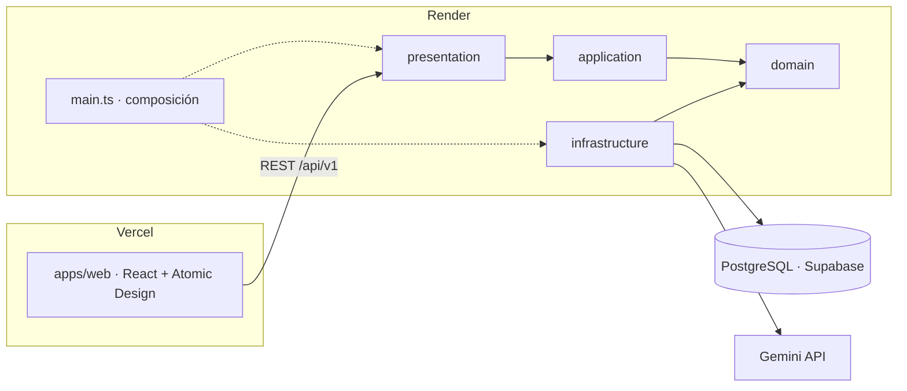

# Arquitectura

El sistema tiene tres piezas desplegadas por separado: frontend, API y base de datos. Todo funciona con planes gratuitos y sin AWS.



## Stack

| Capa | Elección | A tener en cuenta |
| --- | --- | --- |
| Frontend | React + TypeScript + Vite, Atomic Design | Requisito del proyecto |
| Estado asíncrono | TanStack Query | Caché, reintentos y estados de carga y error |
| Formularios | React Hook Form + Zod | Los mismos esquemas validan en cliente y en servidor |
| Gráficas | Recharts | Barras, líneas y donut del dashboard |
| Idiomas | react-i18next, español e inglés | Ningún texto escrito dentro de los componentes |
| Backend | Node.js + TypeScript + Express, Clean Architecture | Requisito del proyecto |
| Persistencia | PostgreSQL con Prisma | Misma base en local y en producción; migraciones y seed versionados |
| Base de datos en producción | Supabase, plan Free | 500 MB por proyecto y 2 proyectos activos; el proyecto se pausa tras 1 semana sin actividad; sin copias de seguridad |
| LLM | Gemini API, capa gratuita, modelo Flash | Salida estructurada nativa; límites por minuto y por día |
| Autenticación | JWT propio: access token corto + refresh token | Sin dependencia de terceros |
| Hosting del frontend | Vercel | Reenvía `/api` a la API: frontend y API comparten origen |
| Hosting de la API | Render, web service Free con Docker | Se duerme tras 15 min sin tráfico; tarda cerca de 1 min en despertar |
| Entorno local | Docker Compose: API + PostgreSQL + web | Un solo comando levanta todo |
| Pruebas | Vitest, Supertest, React Testing Library | Mismo runner en frontend y backend |
| Monitorización | Sentry, plan Developer | 5.000 errores al mes |
| CI/CD | GitHub Actions | |
| Documentación de la API | OpenAPI generado desde los esquemas Zod, con Swagger UI | No puede quedar desfasada |
| Catálogo de componentes | Storybook por niveles de Atomic Design | |

Tres consecuencias de los planes gratuitos son requisitos:

- **Arranque en frío.** La primera petición tras un rato de inactividad puede tardar cerca de un minuto. El frontend muestra «despertando el servidor», no un error.
- **Cuota del LLM.** Al agotarla, Gemini responde 429. La aplicación limita las generaciones por usuario y explica el motivo.
- **Privacidad.** En la capa gratuita, el contenido enviado puede usarse para mejorar los productos de Google. La pantalla de generación avisa de que no se pegue código ni datos confidenciales.

## Monorepo

```
.
├── apps/
│   ├── web/                 # React + Vite
│   └── api/                 # Express + Prisma
├── packages/
│   └── shared/              # esquemas Zod y tipos compartidos
├── docs/
├── .github/workflows/       # ci.yml, deploy.yml, release.yml
├── docker-compose.yml
├── render.yaml               # servicio de la API en Render
├── .env.example
├── CLAUDE.md
├── README.md                # inglés
└── README.es.md             # español
```

`packages/shared` contiene los esquemas Zod de peticiones, respuestas y de la especificación, además de los códigos de error. Frontend y backend los importan desde ahí; de los mismos esquemas sale la especificación OpenAPI.

## Backend: Clean Architecture

```
apps/api/src/
├── domain/
│   ├── entities/            # User, Project, Generation, RefreshToken
│   ├── repositories/        # interfaces de repositorio
│   ├── providers/           # LLMProvider (interfaz)
│   └── errors/              # errores de dominio con su código
├── application/
│   ├── use-cases/           # un caso de uso por fichero
│   └── dto/
├── infrastructure/
│   ├── config/              # variables de entorno validadas al arrancar
│   ├── database/            # Prisma: cliente generado, repositorios, seed y datos de ejemplo
│   └── ai/                  # GeminiProvider, FakeLLMProvider
├── presentation/
│   ├── http/                # app Express, rutas, middlewares, OpenAPI
│   ├── controllers/
│   └── validators/
└── main.ts                  # composición: une implementaciones y casos de uso, y arranca
```

**Regla de dependencias.** Las dependencias apuntan siempre hacia `domain`:

- `domain` no importa frameworks ni librerías de infraestructura: ni Express, ni Prisma, ni el SDK del LLM.
- `application` solo depende de `domain`.
- `infrastructure` y `presentation` dependen de las capas interiores y nunca al revés.
- La composición (qué implementación recibe cada caso de uso) se hace solo en `main.ts`, el único fichero que importa de todas las capas.
- `packages/shared`, que solo contiene esquemas Zod y tipos, se puede importar desde cualquier capa.

Lo comprueba en el CI la regla `no-restricted-imports` de `eslint.config.js` (RNF-01). Cambiar de proveedor de LLM o de base de datos solo toca `infrastructure`.

La interfaz `LLMProvider` se declara en `domain`, junto a las interfaces de repositorio; en `infrastructure/ai` quedan solo las implementaciones. Así los casos de uso no importan nada de infraestructura.

## Frontend: Atomic Design

```
apps/web/src/
├── components/
│   ├── atoms/               # Button, Input, Badge, Spinner…
│   ├── molecules/           # FormField, SearchBar, StatCard…
│   ├── organisms/           # LoginForm, ProjectList, SpecViewer…
│   ├── templates/           # AuthLayout, AppLayout
│   └── pages/               # una por ruta
├── features/
│   ├── auth/
│   ├── projects/
│   ├── ai-analysis/         # generación, historial, edición y exportación
│   └── dashboard/
├── services/                # cliente HTTP y llamadas a la API
├── hooks/
├── i18n/                    # configuración y ficheros es / en
└── types/
```

Reglas (RNF-02):

- Un nivel solo importa niveles inferiores.
- Átomos y moléculas no llaman a la API ni usan estado global.
- Las páginas componen plantillas y organismos; el acceso a datos vive en `features`, `services` y `hooks`.
- Storybook sigue la misma jerarquía.

Las mismas reglas están en `eslint.config.js`, junto con la que prohíbe `dangerouslySetInnerHTML`. Cada componente vive en su carpeta con su CSS Module; los colores y tamaños salen de `styles/tokens.css`.

## Modelo de datos

Cuatro tablas: un usuario tiene muchos proyectos y un proyecto tiene muchas generaciones. Borrar un proyecto borra sus generaciones.

| Entidad | Campos principales | Notas |
| --- | --- | --- |
| User | id, name, email, passwordHash, createdAt | Email único |
| RefreshToken | id, userId, tokenHash, expiresAt, revokedAt | Se guarda el hash, nunca el token |
| Project | id, userId, name, description, techStack, conventions, createdAt, updatedAt | techStack es una lista de etiquetas |
| Generation | id, projectId, type, inputText, additionalContext, status, errorCode, aiSpec, editedSpec, title, complexity, model, attempts, durationMs, inputTokens, outputTokens, isSample, createdAt, completedAt, editedAt | aiSpec y editedSpec son JSONB; title y complexity se copian fuera del JSON para listar y agregar sin leerlo; isSample marca la generación de ejemplo, que no cuenta para los límites de uso |

Valores cerrados: `type` es `feature` o `bug`; `status` es `generating`, `completed` o `failed`. La especificación vigente es `editedSpec` si existe y `aiSpec` en caso contrario.

Al registrarse, cada cuenta recibe un proyecto de ejemplo con una generación marcada con `isSample` (RF-PRO-06). Se crea desde un fichero del repositorio, sin llamar al LLM.

## API REST

20 endpoints bajo `/api/v1`. Todos salvo registro, login, refresh y health exigen un access token válido.

| Método | Ruta | Descripción |
| --- | --- | --- |
| POST | /auth/register | Crea la cuenta e inicia sesión |
| POST | /auth/login | Inicia sesión |
| POST | /auth/refresh | Renueva el access token con la cookie de refresh |
| POST | /auth/logout | Revoca el refresh token |
| GET | /auth/me | Datos del usuario en sesión |
| GET | /projects | Lista los proyectos del usuario |
| POST | /projects | Crea un proyecto |
| GET | /projects/:id | Detalle de un proyecto |
| PATCH | /projects/:id | Edita un proyecto |
| DELETE | /projects/:id | Elimina un proyecto y sus generaciones |
| GET | /projects/:id/generations | Historial paginado con filtros `type`, `status` y `q` |
| POST | /projects/:id/generations | Lanza una generación; responde 202 |
| GET | /generations/:id | Estado y especificación de una generación |
| PATCH | /generations/:id | Guarda la versión editada |
| POST | /generations/:id/restore | Descarta la edición y vuelve al original |
| POST | /generations/:id/regenerate | Crea una generación nueva con la misma entrada; responde 202 |
| DELETE | /generations/:id | Elimina una generación |
| GET | /generations/:id/export | Descarga con `format=md` o `format=json` |
| GET | /dashboard/summary | Indicadores y series para las gráficas, con `from`, `to` y `projectId` |
| GET | /health | Comprobación de vida de la API y de la base de datos |

La especificación OpenAPI se sirve en `/api/openapi.json` y Swagger UI en `/api/docs`. Las dos rutas son públicas, se activan con una variable de entorno y no cuentan entre los 20 endpoints.

Todos los errores comparten formato:

```json
{ "error": { "code": "LLM_RATE_LIMITED", "message": "...", "details": {} } }
```

## Sesión

- No hay cuenta de demostración: el acceso es siempre con una cuenta registrada.
- Access token de 15 minutos, guardado solo en la memoria del navegador, nunca en `localStorage`; al recargar la página se recupera con `/auth/refresh`.
- Refresh token de 7 días en cookie httpOnly, Secure y SameSite.
- El refresh token rota en cada uso; reutilizar uno ya usado revoca todas las sesiones del usuario.
- La cookie viaja porque frontend y API comparten origen: ver «Mismo origen» más abajo.

## Mismo origen

El navegador habla siempre con un solo origen, que sirve el frontend y reenvía `/api` a la API:

| Entorno | Quién reenvía `/api` | Dónde se configura |
| --- | --- | --- |
| Desarrollo | Servidor de Vite | `apps/web/vite.config.ts` |
| Docker local | nginx | `apps/web/nginx.conf` |
| Producción | Vercel | `apps/web/vercel.json` |

Consecuencias:

- La API no necesita CORS y no envía ninguna cabecera `Access-Control-*`.
- La cookie de refresh puede ser `SameSite=Strict`, porque nunca cruza de un sitio a otro.
- Vercel puede guardar en caché lo que reenvía; por eso la API marca todas sus respuestas con `Cache-Control: no-store`.
- La API ve la IP de Vercel, no la del visitante. La del visitante llega en `X-Forwarded-For`; hay que tenerlo en cuenta al limitar intentos por IP y al registrar eventos de seguridad.

Decisión tomada el 10 de octubre de 2026. La alternativa descartada, dos dominios con `SameSite=None`, está en [threat-model.md](threat-model.md).

## Base de datos y migraciones

- En local y en el CI la base de datos es un PostgreSQL en Docker; en producción, Supabase.
- Render y GitHub Actions solo salen por IPv4 y la conexión directa de Supabase es IPv6, así que la API y las migraciones usan el pooler de Supabase en modo sesión (puerto 5432).
- De Supabase se usa solo PostgreSQL. Su API de datos automática queda desactivada: ver [deployment.md](deployment.md).
- La imagen que sirve la API se instala sin la CLI de Prisma y no puede migrar. En local migra el servicio `migrate` de Docker Compose; en producción, quien despliega, hasta que lo haga `deploy.yml`.
- En producción la API exige `sslmode=require` o `sslmode=verify-full` en `DATABASE_URL`.

## Fuentes

Límites y condiciones de los planes gratuitos, consultados el 9 de octubre de 2026:

- [Gemini Developer API pricing](https://ai.google.dev/gemini-api/docs/pricing): modelos Flash gratuitos en la capa Free y uso del contenido para mejorar productos
- [Gemini API rate limits](https://ai.google.dev/gemini-api/docs/rate-limits): límites por proyecto, error 429 y consulta de límites en AI Studio
- [Render: Deploy for Free](https://render.com/docs/free): suspensión a los 15 minutos, arranque de un minuto y caducidad de la base de datos gratuita
- [Supabase pricing](https://supabase.com/pricing): plan Free con 500 MB por proyecto, 2 proyectos activos y pausa tras 1 semana sin actividad
- [Supabase: Connect to your database](https://supabase.com/docs/guides/database/connecting-to-postgres): conexión directa solo por IPv6; pooler en modo sesión para redes IPv4
- [Supabase: IPv4 and IPv6 compatibility](https://supabase.com/docs/guides/troubleshooting/supabase--your-network-ipv4-and-ipv6-compatibility-cHe3BP): Render y GitHub Actions solo aceptan IPv4
- [Sentry pricing](https://sentry.io/pricing/): plan Developer gratuito, un usuario, 5.000 errores al mes y 30 días de historial
- [GitHub Actions billing](https://docs.github.com/en/billing/concepts/product-billing/github-actions): gratuito en repositorios públicos y 2.000 minutos al mes en privados con GitHub Free
