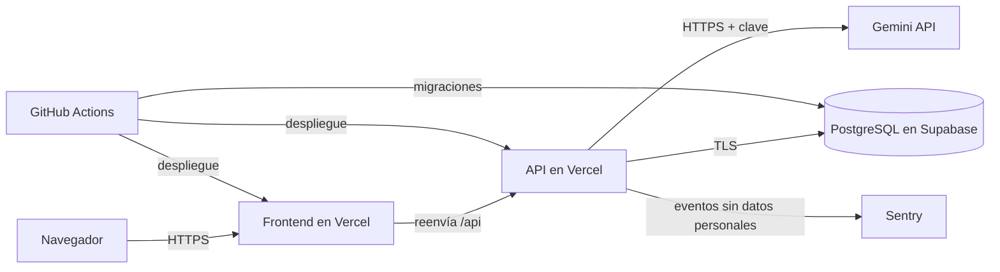

# Modelo de amenazas

Modelo breve de DevPilot AI, redactado el 10 de octubre de 2026, antes de la primera línea de código (SEG-06). Cada amenaza remite al requisito que la mitiga; los requisitos están en [requirements.md](requirements.md).

## Alcance

Entran la aplicación web, la API, la base de datos, la integración con el LLM y el pipeline de CI/CD. Quedan fuera la seguridad interna de los proveedores (Vercel, Supabase, Google, GitHub, Sentry) y los equipos de los usuarios.

## Activos

| Activo | Por qué importa |
| --- | --- |
| Credenciales de usuario | Hash de contraseña y refresh tokens; su robo permite suplantar cuentas |
| Datos de cada usuario | Proyectos, textos de entrada y especificaciones; pueden describir sistemas internos |
| Clave de la API de Gemini | Da acceso a una cuota gratuita limitada y compartida por toda la aplicación |
| Secretos de firma JWT | Quien los tenga puede emitir tokens válidos para cualquier usuario |
| Cuota del LLM y de los planes gratuitos | Si se agota, la aplicación deja de generar para todos |
| Base de datos | Integridad y disponibilidad de todo lo anterior |
| Pipeline y repositorio | Son el único camino a producción y guardan los secretos de despliegue |

## Actores

| Actor | Capacidad |
| --- | --- |
| Visitante anónimo | Llama a los endpoints públicos y puede registrarse sin verificar su email |
| Usuario registrado malicioso | Tiene sesión válida e intenta salir de sus propios datos o abusar de la cuota |
| Atacante automatizado | Fuerza bruta, relleno de credenciales y peticiones masivas |
| Modelo de lenguaje | Componente no fiable: puede devolver contenido inválido, manipulado o inesperado |
| Dependencia comprometida | Paquete de npm, acción de GitHub o imagen base con código malicioso |

## Fronteras de confianza

Nada de lo que llega del navegador ni de lo que devuelve el modelo se considera fiable: ambos se validan en la frontera de la API.

## Amenazas y mitigaciones

| ID | Amenaza | Mitigación | Requisito |
| --- | --- | --- | --- |
| T-01 | Un usuario lee o modifica proyectos y generaciones de otro cambiando el id en la URL | Toda consulta filtra por el usuario en sesión; un recurso ajeno responde 404 | SEG-01, RNF-06 |
| T-02 | Se añade un endpoint nuevo y queda sin autenticación por descuido | Autenticación global con lista explícita de rutas públicas | SEG-15 |
| T-03 | Fuerza bruta o relleno de credenciales contra el login | Límite de intentos en autenticación; mensaje genérico que no revela si el email existe | SEG-07, RF-AUT-02 |
| T-04 | Robo de un refresh token y uso en paralelo con el usuario legítimo | Rotación en cada uso; reutilizar uno ya usado revoca todas las sesiones; se guarda solo el hash | SEG-07, SEG-04 |
| T-05 | Falsificación de tokens: algoritmo `none`, cambio de algoritmo o secreto débil | Algoritmo fijado, secretos aleatorios de 32 bytes o más y distintos para access y refresh | SEG-04 |
| T-06 | Fuga de la base de datos con contraseñas recuperables | Hash con bcrypt o argon2 | SEG-04 |
| T-07 | XSS a través del texto del usuario o de la salida del modelo | Todo se muestra como texto; lint que prohíbe `dangerouslySetInnerHTML`; el Markdown exportado escapa el contenido | SEG-05, SEG-14 |
| T-08 | Inyección SQL | Prisma con consultas parametrizadas, sin SQL construido a mano; Zod en todas las entradas | SEG-05 |
| T-09 | Inyección de prompt: la entrada pide ignorar las instrucciones o revelar el prompt | Texto del usuario delimitado como dato, instrucciones fijas, salida validada contra el esquema; el modelo no tiene herramientas ni puede actuar | SEG-11 |
| T-10 | El prompt arrastra secretos o datos de otros usuarios hacia el proveedor | El prompt contiene solo el proyecto y el texto del usuario en sesión | SEG-12 |
| T-11 | Agotamiento de la cuota del LLM, por abuso de una cuenta o creando cuentas en serie | Límite por usuario, tope global diario, límite de intentos en el registro, longitud máxima en todo texto que entra en el prompt, tope de tokens de salida y tiempo máximo de 45 s por generación | SEG-13, RF-GEN-07, RNF-04 |
| T-12 | El modelo devuelve JSON inválido, incompleto o con contenido inesperado | Validación con Zod antes de guardar, un reintento y, si falla, generación marcada como fallida | SEG-08, SEG-14 |
| T-13 | Secretos en el repositorio, en el frontend o en los logs | Secretos solo en variables de entorno del servidor y en GitHub Actions Secrets; detección de secretos con bloqueo en el push | RNF-05, SEG-19 |
| T-14 | Despliegue en producción con secretos de ejemplo o configuración incompleta | La API se niega a arrancar con valores de `.env.example`, secretos débiles o variables ausentes | SEG-16, SEG-02 |
| T-15 | Swagger UI y la especificación OpenAPI quedan expuestas donde no deben | Desactivadas por defecto; se activan con una variable de entorno | SEG-17 |
| T-16 | Fuga de detalles internos en los mensajes de error | Manejador global: respuesta 500 genérica, sin trazas en producción; ante un fallo se deniega el acceso | SEG-10, SEG-02 |
| T-17 | Dependencia, acción de GitHub o imagen base comprometida | Lockfile, auditoría en el CI, Dependabot y versiones fijadas | SEG-03 |
| T-18 | Código o migraciones que llegan a producción sin revisión | `main` protegida, despliegue solo desde el pipeline y con el CI en verde | SEG-08 |
| T-19 | Un ataque pasa desapercibido | Registro estructurado de eventos de seguridad y alertas en Sentry | SEG-09 |
| T-20 | Datos personales o texto del usuario acaban en la monitorización | A Sentry no llegan contraseñas, tokens, emails ni el texto de entrada; Session Replay desactivado | RNF-16 |
| T-21 | La API se conecta a la base de datos con más permisos de los necesarios | Rol propio en Supabase en lugar de `postgres`; la imagen de la API no lleva la CLI de migraciones | SEG-18 |
| T-22 | Peticiones enormes para tumbar la API | Tamaño máximo de petición de 100 KB y tiempo máximo en toda llamada externa | SEG-02, SEG-10 |
| T-23 | El usuario de ejemplo del seed, con contraseña conocida, acaba en producción | En producción el seed no crea usuarios: solo carga datos en una cuenta existente | SEG-16 |
| T-24 | Un script inyectado roba el access token del almacenamiento del navegador | El access token vive solo en memoria y el refresh token en una cookie httpOnly | RF-AUT-03, SEG-05 |
| T-25 | La API de datos automática de Supabase expone las tablas sin pasar por la API de DevPilot | La API de datos se desactiva en el proyecto de Supabase; solo se usa su PostgreSQL | SEG-02 |
| T-26 | Una caché intermedia guarda y sirve a otro usuario una respuesta de la API | Todas las respuestas de la API llevan `Cache-Control: no-store` | SEG-02 |
| T-27 | Alguien llama a la URL propia de la API, sin pasar por el frontend, para falsear su IP | La API solo confía en la IP que añade la plataforma, nunca en la que envía el cliente; pendiente de configurar y comprobar con el límite de intentos | SEG-07, SEG-09 |
| T-28 | Un despliegue de vista previa ejecuta código sin revisar contra la base de datos de producción | `DATABASE_URL` existe solo en el entorno de producción de Vercel; las vistas previas de la API arrancan sin base de datos y no sirven peticiones | SEG-02, RNF-05 |

## Riesgos aceptados

- **Contenido enviado a Gemini.** En la capa gratuita, Google puede usar el contenido para mejorar sus productos. Se acepta y se avisa junto al formulario de que no se pegue código ni datos confidenciales (RF-GEN-08).
- **Registro abierto, sin verificación de email ni recuperación de contraseña.** Quedan fuera del MVP; se pueden crear cuentas con emails ajenos o inventados y una contraseña olvidada no se recupera. El tope global diario acota el daño sobre la cuota del LLM.
- **Disponibilidad limitada.** Supabase pausa la base de datos tras una semana sin actividad y reactivarla es manual; Vercel puede pausar un proyecto que supere los límites del plan Hobby. No hay protección frente a ataques de denegación de servicio más allá de los límites de uso.
- **Certificado de la base de datos sin verificar, por ahora.** La conexión con Supabase va cifrada (`sslmode=require`), pero no comprueba el certificado del servidor. Pasar a `sslmode=verify-full` con el certificado raíz de Supabase queda para el cierre de seguridad del día 18.
- **Sin copias de seguridad.** El plan gratuito de Supabase no las incluye.
- **Sin análisis dinámico ni escaneo de la imagen Docker.** Son de nivel prescindible.

## Decisión tomada: mismo origen

El frontend y la API son dos proyectos de Vercel y viven en dominios distintos. Una cookie de refresh con `SameSite=Strict` o `Lax` no viajaría entre ellos, y con `SameSite=None` dependería de que el navegador admita cookies de terceros.

Se elige servir la API bajo el mismo origen que el frontend: el proyecto del frontend reenvía `/api/*` al de la API. Así la cookie puede ser `SameSite=Strict`, la API no necesita CORS y el navegador nunca ve el dominio de la API. El detalle está en [architecture.md](architecture.md).

La alternativa descartada era mantener dos dominios con `SameSite=None; Secure` y una defensa adicional frente a CSRF en `/auth/refresh` y `/auth/logout`.

Queda por comprobar en el primer despliegue que el reenvío entre los dos proyectos conserva la cookie y deja a la API conocer la IP del visitante.

## Revisión

Este documento se revisa el día 18, junto con el cierre de seguridad, y cada vez que se añade un endpoint público, un proveedor externo o una capacidad nueva al modelo.
